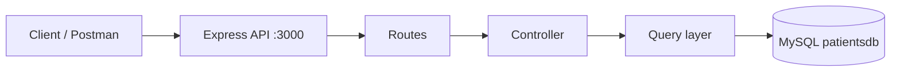

# Patient Management API

REST API for patient records, built with Node.js, Express, and MySQL. The service exposes JSON endpoints for create, read, update, and delete operations, and can run locally or as a pair of Docker containers.

**Repository:** [phuchuydoan/ApiNodejsGenerating](https://github.com/phuchuydoan/ApiNodejsGenerating)

[](https://nodejs.org/)
[](https://expressjs.com/)
[](https://www.mysql.com/)
[](https://www.docker.com/)

---

## Features

- Full CRUD for patient records
- Layered layout: routes, controllers, SQL queries, and response objects
- Connection pooling with `mysql2` (compatible with MySQL 8 authentication)
- Structured JSON responses with HTTP status codes and timestamps
- Request logging with Pino
- Docker image and Compose stack for the API and database
- Environment-based configuration via `.env`

---

## Architecture



| Path                 | Role                              |
| -------------------- | --------------------------------- |
| `src/index.js`       | Application entry point           |
| `src/route/`         | HTTP route definitions            |
| `src/controller/`    | Request handling and status codes |
| `src/query/`         | Parameterized SQL                 |
| `src/config/`        | MySQL pool                        |
| `src/domain/`        | Response envelope                 |
| `dbinit/init.sql`    | Schema bootstrap                  |
| `Dockerfile`         | API image                         |
| `docker-compose.yml` | API + MySQL services              |

---

## Prerequisites

- Node.js 18 or later (22 recommended)
- npm
- MySQL 8, **or** Docker Desktop / Docker Engine with Compose

---

## Getting started

### Environment

```bash
cp .env.example .env
```

| Variable              | Description       | Default      |
| --------------------- | ----------------- | ------------ |
| `SERVER_PORT`         | HTTP port         | `3000`       |
| `DB_HOST`             | MySQL host        | `localhost`  |
| `DB_PORT`             | MySQL port        | `3306`       |
| `DB_USER`             | Database user     | `root`       |
| `DB_PASSWORD`         | Database password | empty        |
| `DB_NAME`             | Database name     | `patientsdb` |
| `DB_CONNECTION_LIMIT` | Pool size         | `10`         |

Do not commit `.env`. Use `.env.example` as the template.

### Option A — Local Node.js and MySQL

```bash
mysql -u root < dbinit/init.sql
npm install
npm run start:dev
```

Verify:

```bash
curl http://localhost:3000/
```

```json
{
  "timeStamp": "10/11/2026, 9:00:00 PM",
  "statusCode": 200,
  "httpStatus": "OK",
  "message": "Patient API, v1.0.0 - All Systems Go"
}
```

### Option B — Docker Compose

```bash
docker compose up -d --build
```

Older CLIs:

```bash
docker-compose up -d --build
```

| Service           | Host port | Container port |
| ----------------- | --------- | -------------- |
| API (`nodeapp`)   | `3000`    | `3000`         |
| MySQL (`mysqldb`) | `3360`    | `3306`         |

```bash
docker compose ps
docker compose logs -f
docker compose down
```

---

## API reference

Base URL: `http://localhost:3000`

| Method   | Endpoint        | Status        | Description                           |
| -------- | --------------- | ------------- | ------------------------------------- |
| `GET`    | `/`             | `200`         | Service health                        |
| `GET`    | `/patients`     | `200`         | List patients (max 100, newest first) |
| `GET`    | `/patients/:id` | `200` / `404` | Fetch one patient                     |
| `POST`   | `/patients`     | `201` / `500` | Create a patient                      |
| `PUT`    | `/patients/:id` | `200` / `404` | Update a patient                      |
| `DELETE` | `/patients/:id` | `200` / `404` | Delete a patient                      |

Unknown routes return `404`.

### Patient payload

```json
{
  "first_name": "Jane",
  "last_name": "Doe",
  "email": "jane@example.com",
  "address": "123 Main St",
  "diagnosis": "Flu",
  "phone": "555-0100",
  "image_url": "https://example.com/jane.jpg"
}
```

`email` must be unique.

### Examples

```bash
# Create
curl -X POST http://localhost:3000/patients \
  -H "Content-Type: application/json" \
  -d '{
    "first_name": "Jane",
    "last_name": "Doe",
    "email": "jane@example.com",
    "address": "123 Main St",
    "diagnosis": "Flu",
    "phone": "555-0100",
    "image_url": "https://example.com/jane.jpg"
  }'

# List
curl http://localhost:3000/patients

# Read
curl http://localhost:3000/patients/1

# Update
curl -X PUT http://localhost:3000/patients/1 \
  -H "Content-Type: application/json" \
  -d '{
    "first_name": "Jane",
    "last_name": "Doe",
    "email": "jane@example.com",
    "address": "123 Main St",
    "diagnosis": "Recovered",
    "phone": "555-0100",
    "image_url": "https://example.com/jane.jpg"
  }'

# Delete
curl -X DELETE http://localhost:3000/patients/1
```

---

## Deployment

The Compose stack is suitable for a Linux VM (for example Amazon Linux on EC2).

```bash
git clone https://github.com/phuchuydoan/ApiNodejsGenerating.git
cd ApiNodejsGenerating
docker compose up -d --build
```

Before exposing the API:

1. Bind a static public address (Elastic IP on AWS).
2. Allow inbound **TCP 3000** on the instance security group or firewall.
3. Confirm locally on the host: `curl http://127.0.0.1:3000/`
4. Call `http://<77.113.147.226>:3000/` from a client.

```bash
ssh -i <key.pem> ec2-user@<public-ip>
```

---

## Scripts

| Command              | Description                             |
| -------------------- | --------------------------------------- |
| `npm run start:dev`  | Development server with Nodemon         |
| `npm run start:prod` | Production start command used in Docker |

---

## License

ISC
